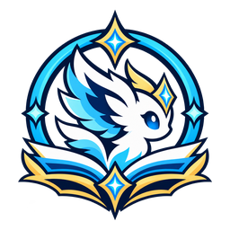

<p align="center"></p>

# AionDex

Overlay para **AION 2** que sigue tu colección de pets en tiempo real, te dice dónde farmear cada uno y te avisa de lo importante sin taparte el juego.

- **Pets**: los pets que puedes farmear en la zona donde estás y con qué mob matar: arriba los que vas matando (el último, primero; uno que llega al nivel máximo se queda unos minutos con su «MAX») y luego el resto, del más cercano al nivel máximo; si no hay ninguno, las estadísticas de tu colección (cuántos pets tienes en cada nivel y en qué %, y cuántos Cogni y Natura tienes al máximo: cada uno suma +1 Might o +1 Precision para siempre). Cada pet dice su familia (Cogni, Fera, Natura, Varian, Special).
- **Pets → Modo Focus**: pone la lista de los pets que estás farmeando dentro del juego, justo debajo de tus misiones (bajo el minimapa) y con su mismo estilo (franja oscura, título dorado, la línea de debajo con lo que llevas esta sesión en una «tecla» y qué matar), y la fila del pet que acaba de sumar se ilumina. Se coloca sola al final de tu lista de misiones (la lee cada 2 s: crece y se acorta con tus misiones). No recibe clics y no sale en tus capturas ni en tus streams.
- **Jefes bajo el minimapa** (píldora **Jefes** abajo en el DPS, o Ajustes > Minimapa; se activa a mano, como el Modo Focus de los pets): en mazmorras, en el mundo y en el Abismo, los jefes, world bosses y cores de asedio que tienes cerca salen debajo de tus misiones, con el estilo de las misiones: su nombre en rojo, el % y una barra de vida, la vida exacta y a cuántos metros están; si te alejas (por ejemplo, peleando contra otros jugadores), siguen ahí con la última vida vista y hace cuánto. Son los jefes que el juego te muestra (los conocidos, siempre) y los objetivos de más de 1 millón de vida en cuanto reciben daño (un core en asedio; los guardias de las ciudades nunca).
- **Pets → Ruta de mobs en el minimapa**: sobre el minimapa del juego, los spawns de los mobs que farmeas alrededor, cada uno vivo (naranja) o muerto con los **segundos que le faltan para reaparecer** (aro rosa: lo mataste tú; gris: lo mató otro jugador; «ya» cuando le toca) y la ruta: un **plan de kills** numerado (1, 2, 3…) pensado para estar siempre matando, no para ir de un punto a otro: el siguiente es el que te deja empezar a pelear antes (lo que tardas en llegar y, si aún no ha salido, lo que falta), mirando 4 kills por delante, con lo que tardas en matar cada mob (lo aprende de tus kills) y su reaparición; así te quedas en un grupo de spawns que van saliendo a tiempo (en una simulación con los spawns reales de Moslan Forest, un 16 % más de kills por minuto que una ruta fija). Si el siguiente aún no ha salido, dice «espera N s». Se arma sola: cada tipo de mob que matas entra en la ruta, y los de pets que ya tienes al máximo no (y salen al llegar); en el panel puedes marcar o quitar cada mob de la zona. El tiempo de reaparición lo aprende viéndolos (un mob nuevo en su punto tras morir el anterior, mientras lo tenías a la vista: p. ej. Mutated Forest Guardian 29 s, Black Ash Basilisk 5 s) y lo guarda; los spawns son los de tu mapa del mundo (caen sobre los reales a 0 m).
- **Mapa de pets**: clic en un pet y ves dónde aparecen sus monstruos, con qué probabilidad de alma, y qué otros pets que te faltan se farmean en esas mismas zonas. Marca los pets exclusivos de **Elyos** o **Asmodian**, y **Pets exclusivos** (en el panel de Pets o la bandeja) los junta en dos pestañas, Asmodian y Elyos: tu progreso con cada uno, qué monstruo lo suelta y dónde, con búsqueda y la opción de ocultar los que ya tienes al máximo.
- **DPS**: medidor de daño en tiempo real para ti y tu grupo, con un panel limpio para la pelea: arriba una tarjeta con el tiempo de combate, el enemigo (su nombre, su vida, la cuenta atrás de su **furia** en rojo si a este ritmo no muere antes) o, contra varios, **Enemigos (N)** con cuántos cayeron y el daño total, y en las mazmorras tu Energía de Odyle y las recompensas que te quedan de esa mazmorra (como las escribe el juego, 75(+15); las de cada mazmorra aparecen tras la primera vez que cobras una allí); abajo una fila por jugador con el color de su clase, su **CP** (lo envía el juego con la lista del grupo), su DPS y su parte (de la vida del jefe en peleas de jefe: todas suman lo que perdió); en peleas de jefe el DPS y el tiempo son los del jefe, desde el primer golpe hasta que muere, como LOXIN (sin los mobs de antes ni los adds de después). Tu party / force la reconoce por las listas del grupo y, si abres AionDex a mitad de sesión (o se actualiza), por los avisos que el juego manda cada pocos segundos de cada miembro (su vida, sus buffs); el enemigo principal es al que más le pegáis tú y tu grupo, y solo los monstruos de rango Héroe cuentan como jefe. El selector **Yo / Party / Force / Todos** aparece cuando hay a quién elegir (Party: tus 5; Force: las 4 parties; Todos: también los que pelean cerca y no son de tu grupo, sin nombre). El **Historial** guarda tus peleas **48 horas** en tu PC (las marcadas con **★**, hasta que las quites) con un botón **Ver** que abre todos los datos de cada una (golpes, críticos, curación, escudos, daño recibido…). Cada visita a una mazmorra sale como una sola entrada con su nombre (Fire Temple…); al abrirla ves solo las peleas de sus jefes, cada una por separado (los mobs de en medio no se muestran), y cada jefe tiene su **Simulación**: la pelea vista desde arriba con tu party (círculos con su foto de perfil o su clase, su nombre y su vida) y el jefe (con su cara y su nombre), cómo se movía cada uno, lo que lanzó el jefe (con el nombre de la habilidad cuando la base de datos lo tiene) y las áreas que dejó en el suelo (olas que avanzan, aros que crecen, zonas de daño, con su nombre o lo que hacen), el **mapa de la mazmorra** de fondo (alineado con las posiciones del juego), las **mecánicas** de cada habilidad del jefe con su forma exacta según las tablas del juego (círculos, anillos, conos, líneas, cruces con sus metros, sobre el jefe, sobre un jugador o donde estaba) y su **barra de casteo** como en el juego (nombre, cuánto lleva y si se interrumpió) y su aviso en el suelo que se llena hasta que cae: área en el suelo, área alrededor del jefe, ataque frontal en cono, golpe al objetivo, daño a todo el grupo, salto o embestida, invoca adds, se potencia, debuffs (anillo morado con los segundos que le quedan), derribos (flecha), **separarse** (una marca sobre cada jugador, con quién le pegó a quién) y **juntarse**, la barra de **aturdimiento** del jefe y cuándo queda aturdido, a quién va el jefe y su **furia**; con reproducir / pausa, velocidad y una línea de tiempo con cada casteo del jefe (pasa el ratón: su nombre), sus aturdimientos, su furia y una **calavera roja** en cada muerte (pasa el ratón para ver quién murió; clic para ir a ese momento). Tu propia posición es aproximada: el juego no te envía tu movimiento, AionDex la saca de tus buffs y habilidades. Solo las peleas de jefes de mazmorra desde la 1.44. En peleas contra jefes las barras cuentan el daño al jefe (lo mismo que LOXIN); con un clic cuentan también el de los adds. En jefes compartidos muestra tu **contribución**, la de tu party y la de tu force, medida contra la vida que pierde el jefe, y la vida restante del jefe (en jefes de campo con mucha gente el juego solo envía tus golpes y el daño periódico de los demás: ahí muestra tu parte y avisa que la de tu force no se puede medir). **Jugadores** (botón del DPS o menú del logo): una ficha por cada jugador de tu party o force, como la pantalla de carga de una partida, con su **CP y su item level** al momento (los envía el juego con la lista del grupo, para toda la force a la vez) y su perfil oficial (legión, equipo con su +N, habilidades con su nivel, Daevanion, estadísticas), con filtros de CP e item level mínimos que marcan en rojo a quien no llega, y enlaces a su página en shugo.gg y en la oficial. **Parties**: propone cómo repartir la force (un Clérigo y un Cantor por party mientras haya, Templarios repartidos, CP parejo) y avisa de lo que no se acumula (Light of Protection y Undefeated Mantra, Earth's Blessing y Power of the Storm, dos Cantores en una party…), con un botón para copiar el reparto al chat. **Detalles del combate**: la contribución completa de cada jugador: daño, curación (la que de verdad llegó a la vida, y la sobrecuración aparte), escudos (cuánto absorbieron y quién los lanzó), daño recibido y muertes, golpes evitados (parry, bloqueo, esquiva, aguante) y aturdimiento (stagger) del jefe, con resumen, filtros (solo al jefe, tu grupo / el resto, clase), búsqueda y el desglose de cada jugador por habilidad, objetivo o enemigo (con las **muertes**, el **aggro** —cuántos enemigos le pegaron a él más que a nadie— y los **revividos** que dio cada healer), una pestaña **Buffs y consumibles** (de ti y tu grupo: la parte de la pelea con **comida, bebida o pergamino** activos, las **pociones** usadas, cuántos **buffs** de clase tuvo cada uno y, a la derecha, cada buff con el **% de la pelea que estuvo activo**, cuántas veces se lo pusieron y quién, y lo que usó; en las peleas de jefe de mazmorra también los **metros recorridos** y el **tiempo muerto**; el nombre de cada comida o bebida lo aprende AionDex la primera vez que tú la usas), una pestaña **Enemigos** con cada enemigo por separado (su vida, si murió, el daño que recibió y quién se lo hizo, el que hizo), la tarjeta del **MVP** y un **Informe**: una imagen con la pelea, los totales del grupo, cada jugador y el MVP, para copiar o guardar. El MVP cuenta todo en vida aportada: daño (al jefe), curación que llegó a la vida, escudos absorbidos, daño evitado, la mitad del daño recibido (aguantar al enemigo) y el aturdimiento (el del grupo vale el 10% de su daño); sus puntos son su parte del total del grupo. Los jugadores de fuera de tu grupo aparecen sin nombre. **Sesiones** (botón **Sesión** del panel o **Sesiones** en Detalles): le pones un nombre, la comienzas y, mientras dura, cada pelea se guarda en ella; al terminarla, el **Informe de sesión** trae cada run (mazmorra, hora, duración, jefes, muertes, mejor DPS y su MVP), el resumen de toda la sesión (runs, jefes derrotados, tiempo en combate, daño, muertes, revividos), cada jugador sumado en todos los runs y el **MVP de la sesión**. Un run termina al cambiar de mapa o al matar al jefe final.
- **Afinador de macros** (parte de **Builds**: su segunda pestaña, y su resumen en el panel de Builds): lee del juego tus habilidades (nivel y especialización), estigmas, pasivas y tus **3 presets** de barra rápida con su orden de prioridad, y los muestra como en el juego (iconos, teclas y niveles); haces clic en las teclas de la barra en el orden de tu macro (el juego guarda el macro en tu PC y no lo envía, así que no se puede leer); tú indicas el retraso de cada paso de tu macro del juego y, si usas uno, tu macro externo (Synapse, iCUE, G HUB…) evento a evento, igual que en tu programa del ratón (pulsar, esperar, soltar); con tus teclas del juego (Macro y Quick Use 1) sabe solo qué hace cada tecla. Durante una prueba compara lo que se lanzó con lo que la recarga de cada habilidad permitía, cuenta las pulsaciones que el juego rechazó, mide tu ping real y te dice qué cambiar. **Calibrar retrasos** te guía por pruebas cortas con distintos valores y te dice cuántos ms poner: cuánto mantener la tecla del macro, la espera entre las teclas de tu macro externo y el retraso de los pasos del macro del juego (o todo en orden), sin confundir el azar con una mejora (y pausando la prueba si te quedas sin maná), luego revisa si tu macro gasta más maná del que recuperas, y **Antes y después** compara tus pruebas («Antes», «Prueba 1», «Prueba 2»…) para ver si el cambio mejoró.
- **Mejoras** (grupo **Personaje** del menú, junto a Builds): qué hacer con tu equipo, en orden. Lee del juego tu equipo y todo lo que tienes en la bolsa y los almacenes (cada pieza con su +N, su nivel de objeto, sus líneas de **Soul Binding** con el porcentaje del juego, sus manastones / soulstones y su Theostone), tu Kinah, Enhance Stones, Transfer Stones, Gear Change Vouchers, Soul Codex, Philosopher's Stones, Amplify Stones y manastones, tus niveles de profesión y las mazmorras que hace cada personaje (los jefes finales que mata él; puedes elegirlas a mano). **Solo te manda a lo que tu personaje puede hacer**: lee su nivel de objeto y su CP del perfil oficial (con los cambios de equipo que hiciste desde entonces) y los compara con lo que pide cada actividad (cada modo de mazmorra, la Trascendencia, el Santuario, Subjugation, las torres de Ascension Trial, el nivel sugerido de Nightmare, las entradas del Abismo); lo que aún no puedes hacer sale como meta con lo que te falta («Ferocious Horn Den: te faltan 561 de nivel de objeto»). Cada paso lleva su etiqueta **↑ ilvl** (sube tu nivel de objeto: equipo nuevo, encantar, Arcana) y/o **↑ CP** (Soul Binding, manastones, Amp, Theostones, Daevanion, stigmas, alas). **Main o alt** (junto al personaje): un main usa todo (Kinah comerciable y ligada, el market y los materiales que se pueden vender); un alt solo lo ligado (Kina (Bound) y lo que no se puede comerciar), nunca el market, y te dice qué tiene comerciable para tu main (y al main, cuánta Kinah comerciable tienen sus alts). Encantar, Substance Morph y Soul Binding se pagan con Kinah ligada o comerciable; el market, solo con la comerciable. Con las tablas del cliente (aion2data: costo de cada nivel de encantamiento, transfer, drops, garantizados de los cubos y Substance Morph) y la guía de kanonxo (las líneas que conviene tener en cada pieza) te arma **Tu ruta**: ponerte lo que ya tienes y es mejor; gastar tus vouchers (por ejemplo 3 Gear Change Voucher de Ferocious Horn Den + 2M = Nuakum Guard, o 1 + 500K = la armadura Nuakum que elijas); encantar hasta donde no falla (+10) solo lo que vas a conservar, con el total; **Soul Binding** de cada pieza (Bind, Sync de las líneas que no sirven o Reset si son mayoría, la línea extra al 100%); los huecos de manastones y soulstones vacíos; el Amp del arma; qué comprar en el market (lo que más nivel da por Kinah y la pieza de la línea Dragon Lord que sigue subiendo hasta 102 con transfer crafting) y qué farmear (con la probabilidad por clear y cada cuántos cubos sale garantizado), los **jefes de campo y del Abismo** del Tracker a los que llegas que sueltan piezas que te sirven, los **Arcana** de la Trascendencia, y **cada semana**: Nightmare hasta el nivel que te toca, las torres, la mazmorra diaria, el Abismo, la Arena y las misiones de deber, con lo que conviene comprar en cada tienda (Nightmare, Abismo, Centuryroot, Festival, temporada) y «Gasta tus Abyss Points» cuando ya tienes para algo que tu ruta usa. **Comida para mejorar**: las piezas que no te sirven y para qué usar cada una (la de menos valor del mismo tipo y grado para el Sync de la tuya, o convertirla en Sync Stone o Transfer Stone), y el paso de Sync te dice directamente cuál comerte. Avisa qué pasa con un transfer (pasan el +N, el Amp y el Soul Binding; se pierden las manastones, la Theostone y la línea extra). La ventana tiene seis pestañas: **Tu ruta** («Lo siguiente» en grande y luego un paso por fila, agrupados en para hacer ya / te falta algo / comprar / farmear / cada semana / cuando subas tu nivel de objeto, con el detalle al abrirlo), **Tus piezas** (una ficha por pieza con barras de +N y Soul Binding y puntos de huecos), **Líneas** (la tabla de líneas recomendadas por pieza del «Substats guide» de r/Aion2, en orden, con las que ya tiene cada pieza tuya y las que sobran, y el truco del transfer: hacer el +10 y las líneas en una Unique de nivel 36 del mismo tipo, que cuesta 325K y 12,960 piedras en vez de 775K y 30,920, y pasarlas; con las reglas del cliente —mismo tipo, 2 Transfer Stones a nivel 86+, desde un tier más bajo solo si tu pieza nunca recibió un transfer— y las piezas de tu bolsa o almacén con mejores líneas que puedes usar de donante, avisando que el transfer pasa también su +N), **Contenido** (todo el contenido del juego: qué pide, si tu personaje puede hacerlo o por qué no, y qué te da), **Comida** y **Preferencias**. Arriba de Tu ruta, un check por **tipo de mejora** (Equipar, Vouchers, Encantar, Soul Binding, Manastones, Amp, Market, Mazmorras, Jefes, Arcana, Actividades y tiendas, Metas, Theostones): lo que desmarcas sale de la ruta de ese personaje (sin Soul Binding, su comida queda libre y las tiendas dejan de ofrecerte Soul Codex). **↻ Actualizar** (arriba) rehace todo en el momento con lo último que leyó del juego y vuelve a pedir tu perfil oficial (nivel de objeto y CP); tu equipo, tu bolsa y tus almacenes se leen solos mientras juegas (un anillo, el cinturón o el amuleto que encantas o te pones se ve al momento, sin volver a entrar). **No quiero hacer este paso** (en cada paso, y en cada opción de los pasos de varias) lo quita y rehace la ruta sin él (una pieza que no vas a conseguir deja de contar como «a cambiar», así que vuelven su encantamiento y su Soul Binding; un Sync que no haces deja libre su comida); en Preferencias está la lista para volver a tenerlos en cuenta (cada personaje los suyos).
- **Arcanas** (grupo **Personaje**, debajo de Mejoras): qué hacer con tus cartas, como el simulador de skills de la comunidad coreana pero con lo tuyo. Lee del juego todas tus arcanas (las cinco que llevas y las de tu bolsa de Arcanas, al entrar o al cambiar de canal; cada una con su +N, su stat principal y sus efectos de skill con los niveles que ganó al mejorarla) y el nivel de cada skill con su desglose (puntos + Daevanion + equipo + arcanas, lo manda el juego). La pestaña **¿Sirven?** es una tabla con todas tus cartas (nombre, tipo, grado, +N, set y un renglón por efecto, con ✓ los de tus skills objetivo) y si sirve —llévala o póntela: la mejor de su tipo, con cuántos de sus efectos te sirven («3/4 sirven»)— o es comida, con su exp y para qué carta va. Por efecto: **Subió** (los niveles que ganó al mejorar la carta: bien, no te sirve o de más) y **Si sube** (qué te da que la próxima mejora le toque: te faltan N, ya llegas o no te sirve; con menos de 4 efectos, cuántos de los posibles te sirven). Si las subidas de una carta que llevas fueron a dar a skills que no buscas más de lo normal, te dice cómo volver a tirarlas (crear otra con las mismas líneas y darle esta de comer: toda su exp pasa). En **Qué hacer**, **¿Vale la pena subirlas?** dice de cada carta que te toca llevar cuántas posibilidades tiene cada mejora de caer en una skill que te falta y si es lo más que una carta de su tipo puede traer de tus skills (**Súbela**), si una de su tipo podría traer más (**Por ahora**: súbela si no tienes otra; la exp no se pierde al dársela luego a una mejor, solo pagas otra vez el Kinah) o si sus subidas ya no van a ninguna skill que te falta (**Solo ilvl**). La exp como comida es la base de su grado más toda la exp de sus niveles (tabla de aion2data, 100 %); cada comida cuesta 5,000 Kinah más la exp que se le puso a esa carta, y la exp que pasa del máximo de la carta se pierde (AionDex lo avisa). En **Set y versión** eliges, por personaje, la versión que quieres de cada carta (Vigor o Magic: su stat de Pantheon y su set; con lo que da cada stat, según la guía de aion2maps) o «da igual», y ves el set que suma; Qué hacer te dice cuál buscar y ¿Sirven? avisa si la que te toca llevar es de la otra. Lo que no elijas: entre cartas que te dan los mismos niveles, gana la versión (Vigor o Magic: su stat de Pantheon) que lleva la mayoría del top de clérigos: Cáliz, Pergamino y Espejo Vigor, Campana Magic. En **Skills objetivo** marcas, por personaje, las skills que quieres subir y le pones a cada una su nivel (o **Sugerir**: las activas de tu barra a 16, la especialización más alta de Global); esa lista, en orden de prioridad (▲ ▼: la de arriba pesa más; cada puesto pesa ×0.75 del anterior), decide Arcanas y Mejoras (abajo). **Qué hacer** va al grano: arriba **tu siguiente paso** con su botón, tus **5 cartas** como tarjetas (versión, +N, efectos con ✓ los tuyos, si ya es la mejor carta posible de su tipo para tus skills o podría salirte una mejor, y el botón **Subir** con su número en el orden para subirlas: primero la que más niveles de tus skills da por cada exp, según tus prioridades, el mismo orden que sigue el siguiente paso y Mejoras; con **Primero las que ya son la mejor posible**, primero las cartas que nunca tendrás que cambiar) y tus **skills objetivo** como barras (nivel con tus mejores cartas / objetivo, cuánto falta y en qué cartas o parte del equipo puede salir); lo del equipo y cómo funcionan las arcanas, plegados. **Subir** te acompaña de un nivel en uno: qué queremos que suba y cuántas posibilidades hay, qué darle de comer solo para el siguiente nivel, y cuando la subes en el juego AionDex ve qué efecto subió (✓ o ✗), lo anota y sigue con el siguiente. Cada vez que mejoras una carta (con o sin Subir abierto), AionDex lo lee del propio registro de la carta que manda el juego y te avisa: «Chalice of Vigor +2: subió Condemnation +2 · ✓ Salió bien» o «✗ No salió: esa skill no está en tus skills objetivo»; las cartas que se comió salen de tu lista al momento. Con **Marcarlas en el juego** (apagado si no lo enciendes), mientras tienes abierta la ventana de Arcanas del juego para mejorar, AionDex enmarca encima de su lista las cartas que le das (azul las que faltan por registrar, verde las ya registradas): lee la pantalla del juego para saber dónde está la lista y qué parte se ve aunque la bajes o filtres por tipo (la lista va por grado, tipo y Vigor antes que Magic, sin las cinco que llevas); lee la pantalla unas 30 veces por segundo, así que los marcos siguen la lista mientras la bajas (las filas a medio ver, recortadas), y debajo del interruptor te dice qué ve (marcando N, cuántas quedan arriba o abajo, o si no ve el juego: tiene que estar al frente, en ventana o sin bordes); no hace clics ni mueve el ratón, y las capturas de pantalla no lo ven. Por dentro te dice: qué cartas ponerte (de cada tipo, entre las de mayor grado, la combinación que más niveles te da en lo que te falta; luego el bonus de set), **qué buscar** en cada carta (el Cáliz puede traer cualquier skill; el Pergamino y la Brújula, seis activas cada uno; la Campana y el Espejo, cinco pasivas cada uno) y **a cuál dar de comer cada carta que no usas**: una carta da la exp base de su grado más toda la que tenía (una Unique +2 da 2,000 + 9,000), así que las mejoradas que ya no sirven también son comida; cuánta exp suma, hasta qué +N llega, cuánto Kinah cuesta y cuántos niveles se esperan en las skills que te faltan (cada +1 añade un efecto hasta tener 4 y luego sube uno al azar, hasta +4; una Unique +5 llega a 9 niveles). Con las Training Arcana de tu bolsa. Si te sale una carta mejor después de subir la que llevas, la nueva compite como quedaría después de darle de comer la tuya (toda su exp pasa y sus subidas se vuelven a repartir entre los efectos de la nueva): te dice que te la pongas y que le des de comer la vieja cuando en promedio te da más niveles en tus skills, aunque la vieja tenga más +N. Mejoras lo lleva como pasos de su ruta (↑ ilvl y ↑ CP: cada +1 sube el nivel de objeto y el stat de la carta) y un recordatorio de cómo mejorarlas. Con skills objetivo, Mejoras también mira las **líneas de skill de tu equipo** (anillos, arma y guarda dan activas; el resto, pasivas): en Líneas cada pieza dice qué skill trae cada una (✓ las tuyas) y la de una skill que no buscas sale «a cambiar» con Sync, cuando esa pieza puede dar una de las que buscas. Al final de **Qué hacer**, **Qué buscar en el equipo**: cada skill objetivo a la que aún le faltan niveles con tus mejores cartas (en orden de prioridad), en qué piezas buscarla (las activas, en los anillos: el top de clérigos deja el arma con stats), qué piezas ya te la dan y qué líneas de skills que no buscas son candidatas a Sync. Datos: aion2data (los pools de cada carta, la tabla de exp y Kinah de cada grado, crear cartas).
- **Builds de skills** (en el menú del overlay: el preset que tienes puesto y a cuál de tus builds corresponde, tus builds con **Comparar** y el resumen del Afinador; la ventana tiene dos pestañas, **Builds** y **Afinador del macro**): guarda en tu PC todas las builds que quieras, más allá de los 3 presets del juego. **Guardar mi preset** toma el que tienes puesto (el juego manda los niveles y especialidades de cada preset al cambiar de preset, y la barra con cada cambio); **Importar de jugador** trae la de cualquier personaje desde su perfil oficial de NCSOFT (lo mismo que muestra shugo.gg: skills, niveles y estigmas equipados; sin especialidades ni barra); **Copiar código** / **Pegar código** para compartirlas por Discord. Junto al nombre de cada build sale **1**, **2** o **3** si la tienes puesta en ese preset del juego (la misma barra y, en el que usas, las mismas especialidades; en dorado el que tienes puesto), y **Actualizar** vuelve a leerla como está ahora: del preset donde la tienes (niveles, especialidades y barra) o, si es de otro jugador, de su perfil oficial. Cada build muestra su barra como la ventana Skill del juego (cada tecla con sus prioridades, la 0 abajo) y su **macro del juego**: con la ventana Macro del juego abierta, **Leer macro del juego** lee sus pasos y delays de la pantalla (el juego guarda el macro cifrado en tu PC y no lo envía), y **Pasarlo al Afinador** lo pone como el macro del preset activo para no tener que marcarlo a mano. Filtro por clase, y **Comparar Mastery** / **Comparar Stigma**: después de copiar la build a mano en la ventana Skill del juego, te dice si todo coincide con tu preset puesto, pestaña por pestaña (puntos, especialidades y en qué tecla y prioridad va cada skill), y qué no coincide. Si cambiaste algo y no se ve, cambia de preset en el juego y vuelve al tuyo: el juego manda entonces todo. (AION 2 no acepta clics simulados —ni SendInput ni enviados a su ventana; solo mueve el cursor—, así que AionDex no aplica la build por ti.)
- **Tracker → Mapa**: cada jefe de campo y del Abismo tiene **Mapa**, que abre el Mapa del mundo en su punto (marcado con un anillo, y tu posición si la muestras), y **Mapa de jefes** los muestra todos: sobre cada punto, el nombre del jefe y su estado en vivo («vivo», «en 12 min», «¿vivo?» si ya debería haber salido, «¿?» si aún no lo sabe), con el color de su estado. Los que tienen varios puntos posibles (Watcher Kaira, Guardian Lord Nahma) salen en todos. Se apaga con «Jefes del Tracker con su estado en vivo» en el panel del mapa.
- **Tracker**: jefes de campo, jefes del Abismo y eventos (Shugo Festival, Arena of Tactics 10 vs 10, asedios, invasiones, grietas, reinicios) como en el juego: foto del jefe, cuánto falta (en tu hora) y su botín destacado con el icono y el color de rareza de cada objeto (pasa el ratón por un set para ver sus piezas). Compara ese botín con lo que lleva equipado tu personaje (AionDex lo lee del juego al entrar) y marca lo que te mejora: «↑ Mejora» o «↑ 3 de 7» en un set, con el detalle de tu pieza actual; «Solo con mejoras» deja solo los jefes que valen la pena para ti. Marca con la campana los que te interesan y AionDex te avisa unos minutos antes de que salgan. Eliges tu región (NA East, NA West, Europa…) y los horarios fijos se calculan con el reloj del servidor, cambio de horario incluido. Los jefes de campo reaparecen según cuándo los matan, y el juego solo lo cuenta en la lista de monstruos de campo del mapa (M) o cuando el jefe está cerca de ti: cada vez que abres esa lista AionDex toma la hora exacta de todos, marca a cada jefe como vivo justo a su hora de regreso, aprende cuánto suelen durar vivos en tu servidor y te avisa que abras la lista cuando un jefe que marcaste en tu mapa lleva demasiado sin confirmarse.
- **Profesiones y Market** (grupo del menú del logo, con cuatro módulos, y una ventana con una sección para cada uno):
  - **Crafting**: las recetas de tu profesión con cuánto tienes de cada material (bolsa y almacén juntos, leídos del juego) y cuántas veces puedes hacer cada una; clic en una receta para ver sus materiales (por intento, lo que tienes, el precio del mercado y lo que te falta para 10 intentos) y clic en un material para ver su precio (el más bajo, su media de 7 días, ofertas, lo que tienes) con botones a su mapa de recolección, su gráfica de precio y Market. En el overlay: lo que puedes craftear ya.
  - **Market**: lo de abajo (rentabilidad por receta, precios de materiales, capturas, muestreos y ventas).
  - **Levear**: qué craftear para subir la profesión a tu nivel: Kinah por punto de experiencia de cada receta (lo que te cuesta cada intento, o lo que ganas vendiéndolo, entre la experiencia que da), con la experiencia que te dio cada receta (o estimada con las de nivel parecido que ya hiciste), tu experiencia en el nivel y lo que pide cada nivel (aprendido al subirlo) para decir cuántos intentos te faltan.
  - **Gathering**: busca por nombre (o por nodo) cualquier material que se recolecte o suelten monstruos y abre su mapa; los que miraste hace poco quedan a mano, también en el overlay.
- **Market** (antes Crafting): ¿vale la pena craftear y vender? Eliges tu profesión (Cocina, Alquimia, Herrería, Armería, Artesanía), la pestaña **Equipo** (los precios del equipo que escaneas en el mercado, con su nivel y si le sirve a tu personaje: lo usa Mejoras) o la pestaña **Materiales** (de dónde sale cada uno: recolectado, procesado, de mobs, de mazmorra, de cofre, combo de un craft o solo del mercado, con los mobs que lo sueltan y su probabilidad al pasar el ratón; los precios de todos los materiales, como Odyle, Wrathful Ego o Wrathful Mind, por tipo, con su media de 7 días, si se venden y cuántas recetas los usan), abres el mercado del juego en su categoría y pulsas **Escanear** (o `Alt+Shift+S`) en cada página: AionDex captura la ventana del juego y lee el texto con el OCR de Windows (el mercado viaja cifrado, la pantalla es la única fuente). Las capturas se ven con una casilla para elegir las buenas; **Procesar** las junta en un muestreo con la fecha y hora. **Rentabilidad**: tu nivel de cada profesión lo lee del juego al entrar con cada personaje y lo sigue mientras crafteas (te avisa al subir, con el mismo sonido que la subida de un pet); eliges con qué personaje calcular y puedes probar otro nivel para ver qué ganarías y ves la ganancia media por intento de cada receta en dos columnas, **recolectando** (lo que recolectas no cuesta y lo que se fabrica, a su coste) y **comprando** todos los materiales: lo que paga el mercado (menos su impuesto, que lee de la pantalla: 10%) × tu probabilidad de éxito con tu nivel − los materiales (un craft que falla los pierde). Los niveles van como en el juego: Novice 1–50 y, tras la misión de ascenso, Professional 1–50 (las recetas piden, por ejemplo, «Professional 25»; puedes escribir «pro 5» en tu nivel). Lee del juego la bolsa y el almacén de cada personaje al entrar y los sigue al craftear, recoger o comprar: cada material dice cuántos tienes (con el desglose bolsa / almacén) y cada receta para cuántos intentos te alcanza («tienes para 3», «te falta 2 Salt»). Aparta las recetas que aún no puedes hacer, recomienda qué hacer con tu nivel (primero lo que se ve vendiéndose) y al abrir cada receta ves qué necesita y de dónde sale (NPC con su precio en Kinah, lo que recolectas, lo que fabricas, o el precio del mercado o el tuyo), cuánto cuesta de cada forma y su combo. Para los materiales procesados (polvos, decoraciones, lingotes…) compara comprarlos procesados con comprar el material raw y procesarlo tú (con la receta más barata que puedes hacer), y clic en un ingrediente que se recolecta o que sueltan los mobs (⌖) abre un **mapa** con solo ese material: sus puntos (o los spawns de los monstruos que lo sueltan, con su drop rate por kill y los kills para un 90%; el mejor % que puedes farmear ahora sale junto al ingrediente y sobre cada zona del mapa) por lado: Elyos, Asmodian o Abismo (en el Abismo solo lo abierto ahora, Chaotic Lower Reshanta, salvo que desmarques la casilla), la zona recomendada con una ruta y la opción de marcar zonas o spawns como «llenos de bots» (se descartan de la recomendación y caducan a los 3 días); cada columna se ordena con un clic en su título, **Informe** crea una imagen JPG con lo importante (con el logo de AionDex) para compartir, copiada al portapapeles y guardada en Imágenes\AionDex, y la columna **Fallo** da tu probabilidad de fallar y lo mínimo que esa receta puede llegar a fallar (las de más nivel nunca bajan tanto). **Ventas**: cuando vendes, escanea la pestaña Settlement del mercado (antes de cobrar) y AionDex guarda cada venta con su captura como prueba (también puedes importar capturas guardadas): lo que cobraste tras el impuesto, lo que te costaron sus materiales y la **ganancia real** (marcas qué materiales compraste y cuáles farmeaste, recolectaste o fabricaste tú: los comprados cuentan al precio medio del mercado del día de la venta, de 00:00 a 23:59, que queda fijo cuando el día acaba para que los cambios del mercado no muevan tu historial; los demás no cuestan, contando los intentos que fallan con el nivel de quien lo fabricó) y el margen, con totales por día, semana, mes o todo, por producto (precio medio, frente al más bajo del mercado, cuánto tarda en venderse), una gráfica de los últimos 14 días y lo que tienes a la venta (escaneando List). Comparando muestreos sabe qué **se vende** (las ofertas que desaparecen; con la pantalla de ofertas de un objeto cuenta unidades) y la **Gráfica de precio** de cada objeto muestra su precio y sus ofertas en el tiempo. **Compartir muestreos** (te lo pregunta la primera vez; casilla abajo en la ventana): tus muestreos van al servidor de AionDex y usas los de los demás usuarios de tu servidor y lado junto con los tuyos (precios más al día, más ventas vistas). Solo viaja lo que se ve en la lista y las ofertas del mercado, nunca tus ventas, tu inventario ni tu personaje; un precio de otro usuario muy distinto de las demás lecturas del mismo objeto no se usa, y el precio que viene de otro usuario lo dice.
- **Status**: la energía de Odyle, los intentos de Nightmare, las llaves del Shugo Festival, la Fisura desconocida (mazmorra diaria), las recompensas de Conquista, los jefes de Santuario, la Exploración y las horas de Abismo de cada personaje, tal como los muestra el juego (75(+15)/840); lo que comparten tus personajes del mismo servidor (las llaves del Shugo Festival y la Fisura desconocida) sale una sola vez, en **Tu cuenta**. AionDex los lee al entrar con cada personaje y calcula los que no estás jugando con sus recargas (+15 de energía cada 3 h, reinicio diario a las 07:00 UTC, semanal el miércoles). Cada contador tiene una luz roja o verde, y cinco alertas (energía casi llena, Nightmare o llaves del Shugo por llenarse, Conquista llena y semanal sin terminar antes del reinicio) se encienden con su campana: avisan con sonido en cuanto se cumplen y luego cada hora mientras sigan igual. Empiezan apagadas.
- **Season M.** y **Logros**: tus misiones de temporada y tus logros (las ventanas Season Mission y Achievements del juego), leídos del juego al entrar y en cada avance (cada kill que cuenta, cada minuto en el Abismo, cada mazmorra). En el overlay, lo que puedes avanzar donde estás: en el Abismo lo suyo (cazar, jefes, PvP, Odyle…), en una mazmorra lo de esa mazmorra, en Altgard o Verteron sus misiones; si ahí no avanza nada, te recomienda las fáciles de hacer desde cualquier lado o entrando tú a una instancia (unirte a una legión, ganar una Arena, derrotar jefes de Nightmare, guardar en el almacén…), con un peso puesto a mano para cada una y más peso a las semanales. Con tu progreso, el paso y las recompensas que te esperan en el juego (y un aviso al completar un paso). Las ventanas **Season Missions** y **Logros** las tienen todas como en el juego, por pestaña y categoría, para cada personaje, con un **Resumen** (completas, en curso, sin empezar, recompensas por recoger y % de pasos, en total y por categoría) y, en Season M., **Expiran pronto**: las semanales sin terminar en las últimas 48 h antes del reinicio del miércoles y las de temporada en su última semana, con un aviso 24 h y 3 h antes. Tu progreso solo se guarda en tu PC.
- **Diagnóstico**: el estado de cada parte de AionDex (lectura del juego, personaje, colección, zona, base de datos, actualizaciones, errores) y un botón por cada problema común. Al pulsarlo, AionDex revisa lo que está recibiendo, arregla lo que puede él solo y te dice qué hacer; si sigue igual, copia un informe (sin tu nombre de personaje ni tu usuario de Windows) para mandárselo al creador o abrir un reporte en GitHub.
- **Detección automática**: personaje, mapa y zona en la que estás (la zona sale de tu posición sobre los contornos del Mapa del mundo cuando AionDex la sabe, que al farmear es casi siempre; si no, de los monstruos de alrededor).
- **Mapa del mundo** (menú del logo y de la bandeja): los 9 mapas (Altgard, Morheim, Ishalgen, Verteron, Eltnen, Poeta y las tres Reshanta) con más de 61.000 puntos, por categoría y cada una con su casilla: servicios (mercaderes, almacenes, mesas de crafteo, teleportadores, instancias…), lugares (entradas de mazmorras, portales, Kibelisks, fisuras, fortalezas…), coleccionables (Hidden Cubes, Empyrean Traces), recolección, NPCs y monstruos (con nombre, élite y por raza). Los nombres y bordes de las zonas (pasa el ratón por un nombre para leer su descripción), un **buscador** (un NPC, un monstruo, un lugar o una categoría entera: los marca con un aro y encuadra el mapa en ellos), **Dónde estoy** y, al pasar el ratón por un punto, qué es. Los puntos vienen de tu propio mapa exportado (`aion2-map.json`), revisado y limpiado: sin repetidos, sin los objetos internos del juego y sin lo que no tiene sitio en un mapa (mazmorras).
- **Dónde estás, en los mapas** (Mapa del mundo, Mapa de pets y mapas de recolección, en los 9 mapas del mundo; la casilla **Mostrar mi ubicación** de cada mapa lo enciende o apaga en todos: apagada, AionDex no lee dónde estás para los mapas): un punto rosa **Tú** y el botón **Dónde estoy** para centrar el mapa en ti (o, si estás en otro mapa de los que tiene la ventana, para ir a él). El juego no te envía tu propio movimiento: AionDex toma tu posición de lo poco que sí la dice (al entrar a un mapa, tus buffs, tus habilidades, el nodo que recolectas) y, entre medias, **lee el minimapa del juego**: lo encuentra en la pantalla por su título (el nombre de la zona) a cualquier resolución o tamaño de interfaz y lo compara con el mapa del mundo (unos 5 m de error). Necesita ver el minimapa: si otra ventana lo tapa (también una de AionDex), el punto se queda donde te vio por última vez y dice hace cuánto. Con el minimapa a la vista, el punto lleva también el **cono de la cámara** (hacia dónde miras), leído del propio minimapa. Si abres AionDex con el juego ya en marcha, recuerda el mapa de la sesión anterior o lo deduce del nombre de la zona del minimapa. «Dónde estoy» centra el mapa y **te sigue** hasta que lo arrastras.
- **Nodos en vivo** (mapa de recolección): los nodos del material que el juego te muestra alrededor, sobre el mapa: disponibles (verde, con las cargas que les quedan; **¡nuevo!** si acaban de aparecer) y **agotados**, con un reloj de cuánto suele tardar en salir otro en ese punto, y arriba un resumen («2 disponibles · 1 agotado, el próximo en ~2:10»). Cada punto da siempre el mismo material, pero el juego no repone a hora fija (en un mismo punto se vio de 10 s a 9 min): AionDex aprende cuánto tarda cada tipo de nodo mirando cuándo reaparecen (los tuyos y los de los demás) y te avisa con un aro rosa de los que recolectaste tú. El material de cada tipo de nodo lo aprende la primera vez que recolectas uno. El juego no dice cuándo saldrá el siguiente (no hay tiempo oficial; en un mismo punto se vio de 10 s a 9 min): AionDex lo estima con lo que ve. Si pasas a menos de 35 m de un punto y el juego no te muestra ningún nodo ahí, lo marca **vacío** (alguien lo recolectó), con la hora en que lo viste.
- **Elegir la zona** (mapa de recolección): **Farmear aquí** en cualquier zona hace que su ruta sea la dibujada en el mapa y en el minimapa del juego; **Volver a la recomendada** lo deshace.
- **Más puntos de recolección**: el mapa de recolección suma a los de metabot los nodos de tu mapa que metabot no tiene (unos 26.000 entre todos los materiales; los 14 nodos de Odyle que tu personaje vio en Altgard están en él a 0,1 m).
- **Corroborado con tu personaje** (mapa de recolección): los puntos de metabot donde viste un nodo quedan **confirmados**; los que encontraste vacíos en 3 visitas distintas sin ver nunca un nodo quedan como **dudosos** (borde punteado: puede que ese punto no exista); y los puntos que el juego te mostró y metabot no tiene se guardan y se dibujan. Todo se queda en tu PC.
- **Ruta en el minimapa del juego** (casilla en el mapa de recolección): dibuja encima del minimapa del juego la ruta recomendada del material, sus nodos (verde: a la vista; X: agotado o vacío) y una línea al más cercano con su distancia, y se mueve contigo (lee el minimapa unas seis veces por segundo y, entre lectura y lectura, mueve el dibujo con tus teclas de movimiento —W A S D o las flechas, según hacia dónde mira la cámara— a la velocidad a la que te vio moverte; sin teclas, como en auto-correr, con la velocidad de las lecturas: así arranca, frena y gira contigo). Sigue aunque minimices o cierres la ventana del mapa (desmarca la casilla para quitarlo). Es una capa transparente que no recibe clics y que las capturas de pantalla no ven: no sale en tus capturas ni en tus streams. No parpadea: si una lectura del minimapa falla, sigue dibujando (moviéndose contigo) y solo se oculta si minimizas el juego o algo tapa el minimapa. Todo se dibuja dentro del minimapa; si el nodo siguiente queda fuera, una flecha en el borde apunta hacia él con su distancia. Si el minimapa no se puede leer un rato, la ruta sigue centrada en tu posición del juego (la de los mapas), con el último tamaño conocido del minimapa. El minimapa se encuentra por el marco de su mapa (sus bordes y su forma), no por colores: la barra del título es transparente y el mundo detrás cambia. Con mobs cerca, AionDex usa los **circulitos** que el minimapa pone a cada mob: sabe del juego dónde está cada uno, así que si 3 o más circulitos coinciden te sitúa con ellos (1-2 m más exacto que comparando el mapa) y la ruta cae justo sobre los mobs del minimapa. **Ajustes > Minimapa > Calibrar esquinas**: arrastra 4 marcadores a las esquinas del mapa del minimapa y la ruta se dibuja exactamente ahí (se guarda por tamaño de la ventana del juego; **Automático** vuelve a encontrarlo solo).
- **Jugadores** (party, force, Arena): clic en un jugador abre su perfil como la ventana de inspección del juego: su equipo en sus casillas con icono, +N y color de grado, su CP o item level (clic para cambiar) y sus estadísticas; clic en una pieza muestra su detalle como en el juego (estadísticas con el bonus del enchant, soul binding y su %, manastones, theostones, skin), pedido a la página oficial en ese momento. La pestaña **Skills y Daevanion** tiene sus activas, pasivas y stigmas (icono, nivel en la esquina, E en las equipadas) y sus tableros de Daevanion; clic en una skill muestra qué hace y su daño, reutilización y MP a su nivel (datos de aion2data).
- **Arena**: al entrar a una partida, el DPS muestra a tu rival (o a los 10 en 5v5) con su clase, CP, item level y rating de Arena, que el juego manda al empezar con el servidor de cada uno. Sus perfiles oficiales (los de NCSOFT, los mismos que muestra shugo.gg) se piden a su propio servidor, de uno en uno, primero los rivales; clic en la tarjeta o en **Arena** abre la ventana con el equipo, las habilidades, el Daevanion y un botón a su página de shugo.gg. Cada rival lleva el estado de su **Defiance** (el que rompe aturdimientos y derribos): **DEF ✓** listo, **INMUNE 5s** durante su Tenacity tras usarlo y luego **DEF 36s**, lo que le falta (su enfriamiento, el que manda el juego en su cast). Solo en la Arena (1v1 y 5v5), nunca en el Abismo ni en otro PvP.
- **Pase**: el Daeva Pass de cada personaje, leído del juego: nivel y EXP dentro del nivel, la EXP de la semana contra su tope (10,510/15,000…), Premium o Básico, cuántas recompensas tienes por recoger y cuándo termina; y en corto el de tus otros personajes. Season M. y Logros muestran también sus recompensas.
- **Dashboard** (el primero del menú, para tenerlo abierto mientras juegas): recuadros con el reloj local y el del servidor, la siguiente actividad que marcaste en el Tracker y cuánto falta, cuántas pets puedes subir a nivel máximo donde estás, una misión del evento, una semanal de temporada y un logro (los que puedes avanzar donde estás, o los que te faltan uno tras otro cada pocos segundos, y primero los que tienen recompensa por cobrar) y un aviso cuando Status necesita atención (clic y te lleva a Status). Cada recuadro se oculta cuando no tiene nada que mostrar; con **Editar** eliges cuáles salen.
- **Eventos**: los eventos del juego en marcha, de los avisos oficiales de AION 2 Global. En el overlay, cuándo termina cada uno, lo que más paga y cuándo se renuevan sus misiones semanales; en la ventana, cada evento con su imagen: qué hacer, **cuántas monedas puedes juntar** (y si alcanzan para comprar todo lo que tiene límite), los días de **asistencia**, las **misiones** con su recompensa, la **tienda** con precio, límite, nivel y fecha de borrado, otras tablas (llaves, caramelos…) y lo importante, con el enlace al aviso oficial. Las **misiones del evento** (Season Mission → Event) se leen del juego como las demás: tu progreso sale en la ventana de Eventos, en el overlay y en una pestaña **Evento** de Season M. (con aviso cuando hay algo por cobrar). La lista oficial de eventos de NCSOFT se lee cada 6 horas: un evento nuevo aparece aunque AionDex aún no tenga sus detalles.
- **Notificaciones**: globos al costado del overlay (progreso, subidas de nivel, pets nuevos, zona) y una lista con solo lo importante, para que se pueda leer: problemas, alertas de Status (energía llena…), un pet al nivel máximo, una misión o un logro completado, misiones que expiran y versiones nuevas. Sonidos propios para la subida de nivel de un pet, los avisos de jefes y los de eventos, las alertas de Status y cuando muere tu personaje, cada uno con su volumen o silenciado por separado (**Ajustes → Sonidos**).
- **Se actualiza solo** con actualizaciones firmadas.

## Instalación

1. Instala **[Npcap](https://npcap.com/#download)** (gratis; AionDex lo usa para leer el tráfico del juego).
2. Descarga **`AionDex-Setup-x.y.z.exe`** de la [última release](https://github.com/fcastro93/aiondex/releases/latest) y ejecútalo. No pide permisos de administrador.
3. Abre AionDex **antes** de entrar con tu personaje (así recibe tu colección completa al hacer login).

> Windows puede mostrar "Windows protegió su PC" porque el instalador no tiene firma de un editor comercial: **Más información → Ejecutar de todas formas**.
>
> El juego debe estar en modo **ventana** o **ventana sin bordes** para ver el overlay encima.

## Uso

| Atajo | Acción |
|---|---|
| `Alt+Shift+P` | Mostrar / ocultar |
| `Alt+Shift+L` | Bloquear / desbloquear (bloqueado: los clics pasan al juego) |
| `Alt+Shift+C` | Compacto / expandido |
| `Alt+Shift+M` | Mapa de pets |
| `Alt+Shift+S` | Escanear el mercado (Crafting) |

- **Pets → Ver toda la colección** (o «Colección de pets» en la bandeja): todos los pets con tu progreso, en pestañas **Todos / Subiendo / Sin empezar / Al máximo**, filtros por lado (solo Asmodian, solo Elyos, ambos), por **origen** de su alma (monstruos del mundo abierto, jefes del mundo abierto, Abismo, mazmorras e instancias, solo en mazmorras, solo de cofres), por **mapa** (cada región, capa del Abismo o mazmorra) y por **zona** de ese mapa, cada uno con cuántos pets tiene, y buscador por pet, monstruo, zona, mazmorra o cofre; cada tarjeta dice de dónde sale (Mazmorra, Jefe de mundo abierto…), qué monstruo lo suelta y dónde, y un clic lo abre en el mapa.
- **Diagnóstico → «El overlay parpadea»**: graba un minuto lo que le pasa al overlay en ese PC (cambios de tamaño, si se oculta o pierde el «siempre encima», qué programas ponen ventanas encima —Discord, NVIDIA, Xbox Game Bar…—, si el juego está en pantalla completa exclusiva, cuánto tarda en redibujarse, gráficas y pantallas) y dice las causas probables, con un informe para copiar.
- Clic en el **logo** de la cabecera: menú (**Pets**, **DPS**, **Personaje ›** —**Mejoras**, **Arcanas** y **Builds**, con el Afinador del macro dentro—, **Tracker**, **Crafting**, **Status**, **Progreso ›** —un submenú con **Season M.**, **Logros**, **Pase** y **Eventos**—, **Notificaciones**, **Diagnóstico**, **Ajustes**, **Reiniciar** —cierra AionDex y lo vuelve a abrir, por si algo se traba— y **Salir**).
- **Ajustes → Idioma / Settings → Language**: los textos de AionDex en **English** (el idioma por defecto) o en **Español**; se aplica al reiniciar (botón **Reiniciar ahora**). Lo que viene del juego (pets, monstruos, objetos, mapas, mazmorras, clases, habilidades) sale siempre como lo manda el juego.
- **Ajustes → Sistema → Abrir siempre como administrador**: el juego corre como administrador y solo así AionDex ve las teclas que pulsas en él (la ruta del minimapa se mueve con ellas); usa una tarea programada de Windows para que no pregunte cada vez.
- **Ajustes → Accesibilidad → Tamaño de todo**: de 100% a 150% de 10 en 10 (150% = «Modo Marvin»): agranda el overlay, las ventanas, los textos y los iconos para quien ve poco; se aplica al reiniciar (botón **Reiniciar ahora**).
- Desbloqueado se puede arrastrar; clic en un pet abre el mapa; clic derecho lo fija como objetivo.
- El icono en la bandeja del sistema tiene opacidad, tamaño, notificaciones y más.

## Actualizaciones

AionDex busca actualizaciones al abrirse y cada pocas horas, y las instala solo (se cierra y vuelve a abrirse). Si el juego está abierto, espera: se instala sola cuando cierras el juego, para no cerrarse mientras juegas. También puedes forzarlo en **Ajustes → Buscar updates**.

**Si Windows borra o bloquea AionDex** (Windows Defender o Smart App Control pueden confundirlo con un virus, porque lee el tráfico del juego, hace clics por ti y se actualiza solo, y aún no está firmado con un certificado): en **Seguridad de Windows → Protección contra virus y amenazas → Historial de protección**, elige la entrada de AionDex → **Acciones → Restaurar** (o Permitir en el dispositivo), y en **Administrar la configuración → Exclusiones** agrega la carpeta `%LOCALAPPDATA%\Programs\AionDex`. Luego vuelve a instalarlo desde Releases si hace falta (tus datos se conservan).

**Si el overlay desaparece**: Alt+Shift+P (o un clic en el icono de AionDex junto al reloj) lo oculta y lo muestra; al ocultarlo así, AionDex te avisa cómo volver a verlo. Si el juego está en pantalla completa exclusiva, nada puede dibujarse encima: usa «Ventana sin bordes» en sus opciones de vídeo. **Si se cierra solo**: Diagnóstico → «Se cerró solo o da errores» → **Copiar informe**, y envíalo.

Cada release incluye un manifiesto **firmado** (Ed25519). La app solo instala un instalador cuyo hash coincide con un manifiesto firmado por la clave del autor, y solo si es una versión más nueva: aunque alguien subiera un archivo falso, la app lo rechazaría.

## Privacidad y avisos

- AionDex solo **lee** el tráfico de red de tu propio cliente (con Npcap). No modifica el juego, no lee su memoria y no envía nada a ningún servidor.
- Se conecta únicamente a GitHub (actualizaciones) y a [metabot.gg](https://metabot.gg/en/aion-2) (iconos y mapas).
- Tus datos (colección, ajustes, historial, configuración de tus macros) se guardan en `%LOCALAPPDATA%\AionDex`.
- Con la ruta en el minimapa activa, AionDex mira si tienes presionadas las 8 teclas de movimiento (W A S D y las flechas), solo mientras la ventana del juego está al frente, para mover el dibujo contigo. No mira ninguna otra tecla ni guarda nada.
- Los mapas leen el **minimapa** del juego (solo ese recuadro, y para encontrarlo una vez cada poco el cuarto de arriba a la derecha) más o menos una vez por segundo (unas seis con la ruta en el minimapa), solo mientras tienes abierta una ventana de mapa o la ruta en el minimapa; se procesa en tu PC y no se guarda.
- Crafting solo captura la ventana del juego cuando pulsas Escanear; el texto se lee en tu PC (OCR de Windows) y la captura se borra al procesarla (o cuando la borras tú). Los muestreos guardan solo nombres de objetos, precios y ofertas.
- Crafting guarda de tu bolsa y tu almacén solo los objetos que usan o fabrican las recetas, en tus ajustes. Las capturas de tus ventas (Settlement) se guardan como prueba en tu PC; las demás se borran al procesarlas.
- Status solo lee los contadores de tus propios personajes (energía, entradas y tickets) y los guarda en tus ajustes.
- **Jugadores** pide el perfil público de los de tu party/force al sitio oficial de NCSOFT (aion2.plaync.com) solo cuando abres la ventana, pulsas Refrescar o alguien nuevo entra al grupo con la ventana abierta, de uno en uno y antes que cualquier otra petición: primero el CP y el item level de todos (los que aún no tienen CP, primero; unos 16 segundos para una force de 16) y luego su equipo; lo guarda 30 minutos en tu PC.
- El medidor de DPS solo muestra nombres de tu party/force; el resto de jugadores aparece como «Jugador N». Las peleas se guardan 48 horas solo en tu PC (las marcadas con ★, hasta que las quites), con los de fuera de tu grupo ya sin nombre; nada se sube.
- Proyecto de fans, **no afiliado a NCSoft**. Usar herramientas de terceros puede ir contra los términos del juego: úsalo bajo tu responsabilidad.

Datos de pets, monstruos y mapas, y horarios, jefes y botín del Tracker: [metabot.gg](https://metabot.gg/en/aion-2). Objetos, niveles de objeto y contenido de los cofres, y recetas, tiendas de NPC y materiales de Crafting: [aion2data.com](https://aion2data.com/). Puntos de recolección, zonas y monstruos que sueltan materiales: [metabot.gg](https://metabot.gg/en/aion-2/gathering). Límites y recargas de Status: [metabot.gg](https://metabot.gg/en/aion-2/weekly-reset) y [aion2data.com](https://aion2data.com/checklist). Pases (nombres y fechas): [aion2data.com](https://aion2data.com/season). Misiones de temporada y logros (nombres, qué piden, sus pasos y recompensas): [metabot.gg](https://metabot.gg/en/aion-2/achievements). Nombres de monstruos y furia de los jefes del DPS: [aion2data.com](https://aion2data.com/monsters). Mejoras (costos de encantar y del transfer, drops, garantizados de los cubos, Substance Morph, los rangos de cada línea de Soul Binding, lo que pide cada actividad, Nightmare, las torres, el Abismo y las tiendas) y familias de pets: [aion2data.com](https://aion2data.com/); las líneas buscadas por pieza y las reglas de Soul Binding, manastones y Theostones: la [Aion 2 Bible de kanonxo](https://docs.google.com/document/d/11u4wLCG1WfL-xSka2Aze0rI9vYRa7mq3N3Gp1bt0AWY/edit). Puntos del Mapa del mundo: tu propio mapa exportado (`aion2-map.json`, ver `tools/build_world_db.py`); las imágenes de los mapas, de metabot.gg.

## Desarrollo

Requiere Windows, Python 3.13 y Npcap.

```
pip install -r requirements.txt
python run.py                 # overlay
python run.py --preview       # datos de ejemplo y kills simulados, sin el juego
python update_pet_db.py       # regenera data/pets_db.json y data/map_db.json desde metabot.gg
python tools/build_tracker_db.py <event_items.json> [catalog.json]   # regenera data/tracker_db.json
python tools/build_crafting_db.py <recipes.json> <shops.json> <items.json> <drop-rates.json> <monsters.json>   # regenera data/crafting_db.json (aion2data)
python tools/build_npc_db.py <monsters.json>   # regenera data/npc_db.json (aion2data: nombres y furia de los jefes)
python tools/build_upgrades_db.py <carpeta raw de aion2data>   # regenera data/upgrades_db.json (Mejoras)
python tools/build_pet_families.py <best.json>   # regenera data/pet_families.json
python tools/build_pet_sources.py <carpeta raw de aion2data>   # regenera data/pet_sources.json (de dónde sale cada alma)
python tools/build_arcana_db.py <carpeta raw de aion2data>   # regenera data/arcana_db.json (cartas, pools, exp de cada grado)
python tools/build_gather_db.py   # regenera data/gather_db.json (puntos de recolección y drops, metabot)
python tools/build_world_db.py [aion2-map.json]   # regenera data/world_db.json (Mapa del mundo) desde tu mapa
python tools/i18n_catalog.py      # rehace pet_overlay/locale/es.json y revisa en.json (textos sin inglés, placeholders)
python tools/i18n_catalog.py missing   # los textos que aún no tienen inglés (id <tab> español)
python build_exe.py --installer   # dist/AionDex/ y dist/installer/AionDex-Setup-<versión>.exe (Inno Setup 6)
```

Idiomas (`pet_overlay/i18n.py`): los textos se escriben en español en el código y pasan por `tr("Tienes {0} de {1}", a, b)`; `pet_overlay/locale/en.json` tiene su inglés por id. Un texto que el código guarda como clave (un rol, el nombre de un botón del ratón) se marca con `N_()` y se muestra con `tr(valor)`. Los textos propios de los archivos de datos (guías de eventos, eventos del Tracker, pestañas de misiones, créditos) están en `i18n.DATA_TEXTS` y se traducen al cargarlos (`tr_data`). Un texto sin inglés sale en español; `tools/i18n_catalog.py` lo avisa.

Publicar una versión (solo el dueño del repo): subir `__version__` en `pet_overlay/__init__.py`, hacer commit y crear el tag `vX.Y.Z`. El workflow `Release` compila, firma y publica el instalador.

| Ruta | Qué hay |
|---|---|
| `pet_overlay/sniffer.py`, `stream.py`, `protocol.py` | Captura, reensamblado TCP, mensajes y paquetes LZ4 |
| `pet_overlay/pets.py`, `character.py`, `world.py` | Colección (`0090`/`0d90`/`1490`), personaje (`3336`), mapa y NPCs (`2136`/`4136`/`4236`) |
| `pet_overlay/contribution.py`, `damage.py`, `combat.py` | Daño, curación, escudos, daño recibido, evitado y aturdimiento (`0438`, `0538`, `05e0`, `1b92`), muertes (`048d`), jugadores (`4536`) y peleas |
| `pet_overlay/sessions.py`, `ui/session_report.py` | Sesiones: runs con la misma party, totales, MVP e informe |
| `pet_overlay/fightlog.py`, `mvp.py`, `ui/dps_report.py` | Peleas guardadas 48 h (★ las conserva), MVP e informe de combate |
| `pet_overlay/ui/dps_party.py`, `npcs.py` | Vista de party del DPS: CP del grupo (`0092`/`0296`/`1b96`/`2292`, el tuyo en `5636`), furia y nombres de los jefes (`data/npc_db.json`) |
| `pet_overlay/metabot.py`, `dbupdate.py`, `mapdata.py` | Base de datos de pets, monstruos y zonas |
| `pet_overlay/whereami.py`, `minimap.py`, `ui/mapview.py` | Tu posición en los mapas: entrada al mapa (`2136`), tus buffs y habilidades (`2a38`/`2b38`), y el minimapa del juego (OCR de Windows + correlación con el mapa del mundo, numpy) |
| `pet_overlay/arcana.py`, `ui/arcanawindow.py`, `tools/build_arcana_db.py` | Arcanas: las cartas en la lista de objetos (`1156`/`1b56`, contenedores 11 y 14), el desglose del nivel de skill (`0051`), qué ponerse, qué buscar y qué dar de comer (`data/arcana_db.json`, aion2data) |
| `pet_overlay/builds.py`, `buildmacro.py`, `macroread.py`, `winput.py`, `ui/buildswindow.py`, `ui/calibrationwindow.py` | Builds de skills: presets (`0051`, `8ce2`, `90e2`, `93e2`), perfil oficial, códigos y el plan para pasar de tu preset a una build |
| `pet_overlay/nodes.py` | Nodos de recolección en vivo: aparición (`3436`), recolección (`3836`/`3a36`/`338d`), agotado (`3536`) y lo que tarda cada tipo en reponerse |
| `pet_overlay/ui/minimapoverlay.py` | La ruta dibujada sobre el minimapa del juego (ventana transparente excluida de las capturas) |
| `pet_overlay/mobs.py`, `ui/focuspanel.py` | Pets: reapariciones de los mobs (`4136`/`048d`/`4236`) para la ruta de mobs del minimapa, y el Modo Focus bajo la lista de misiones del juego |
| `pet_overlay/ui/worldmap.py`, `tools/build_world_db.py` | Mapa del mundo: tus puntos (`data/world_db.json`) por categoría, zonas y búsqueda |
| `pet_overlay/tracker.py`, `ui/trackerwindow.py` | Horarios de jefes y eventos, lista de jefes de campo (`0191`) y avisos |
| `pet_overlay/crafting.py`, `market_ocr.py`, `professions.py`, `gathering.py`, `ui/craftingwindow.py`, `ui/gathermap.py` | Crafting: capturas del mercado, OCR, muestreos, niveles de profesión (`3336`, `7c8d`, `7d8d`, `6f8d`), coste y ganancia de cada receta, ventas y gráficas |
| `pet_overlay/market_share.py`, `server/market/` | Muestreos compartidos: el cliente y el servidor (Cloudflare Worker + D1, plan gratuito) |
| `pet_overlay/sales.py`, `ui/salesview.py` | Ventas: Settlement / List leídos por OCR, pruebas, coste, ganancia y estadísticas |
| `pet_overlay/inventory.py` | Tu bolsa y almacén para Crafting (`1156` al entrar, `1b56` cuando cambian) |
| `pet_overlay/armory.py`, `forceplan.py`, `ui/playerswindow.py` | Perfiles oficiales de tu grupo (CP, equipo, habilidades), filtros y reparto de la force |
| `pet_overlay/status.py`, `ui/statuswindow.py` | Status: energía y tickets de cada personaje (`0b61` al entrar, `0c61` cuando cambian), recargas y alertas |
| `pet_overlay/missions.py`, `modules/missions.py`, `ui/missionswindow.py`, `tools/build_missions_db.py`, `tools/build_achievements_db.py` | Season M. y Logros: progreso (`8356` al entrar, `8456` en cada avance), las listas con los ids del juego, dónde avanza cada uno y su peso para las recomendaciones |
| `pet_overlay/i18n.py`, `locale/`, `tools/i18n_catalog.py` | Idioma de la app (English / Español): `tr()`, los catálogos y su revisión |
| `pet_overlay/modules/` | Funciones del overlay (Pets, DPS, Afinador, Tracker, Crafting, Status, Notificaciones, Diagnóstico, Ajustes) |
| `pet_overlay/notifications.py`, `ui/toasts.py` | Notificaciones e historial |
| `pet_overlay/events.py`, `modules/events.py`, `ui/eventswindow.py` | Eventos del juego en marcha (data/events.json y la lista oficial) |
| `pet_overlay/upkeep.py` | Buffs y consumibles de cada jugador (tiempo activo, pociones, comida) |
| `pet_overlay/mechanics.py` | Mecánicas de cada habilidad de un jefe (barra de casteo, forma, derribos, debuffs, saltos, adds, aturdimiento) |
| `data/boss_skills.json` (`tools/build_boss_skills.py`) | Formas de los ataques de los jefes, estados y mapas de mazmorras: tablas del cliente que publica [Waffle meter](https://github.com/Waffle-ens/waffle_meter) (licencia MIT, Copyright (c) 2026 TK-open-public) |
| `pet_overlay/simulation.py`, `ui/simwindow.py` | Simulación de las peleas de jefe en mazmorras (posiciones, muertes, áreas del jefe) |
| `pet_overlay/updater.py`, `update_controller.py`, `tools/sign_release.py` | Actualizaciones firmadas |
| `pet_overlay/ui/` | Interfaz (Qt) |
| `installer/aiondex.iss`, `.github/workflows/release.yml` | Instalador y publicación |
